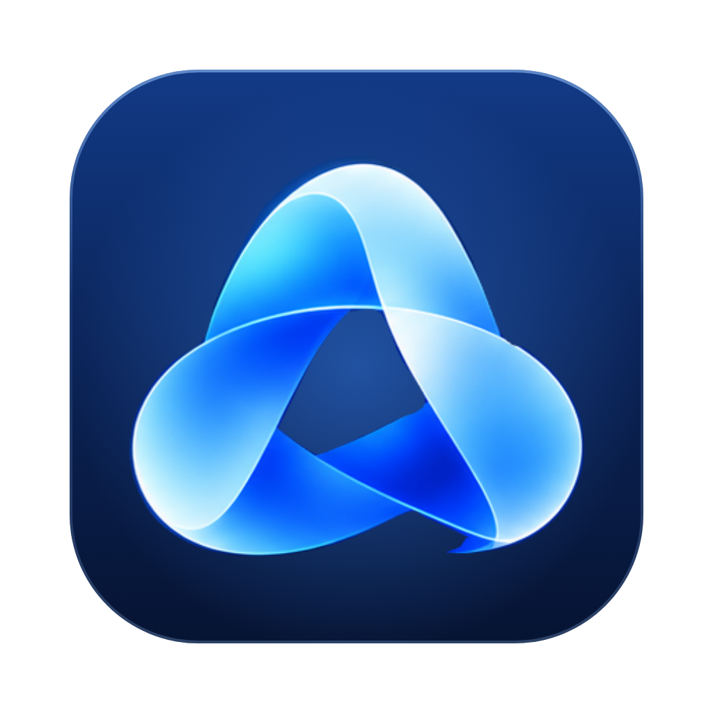
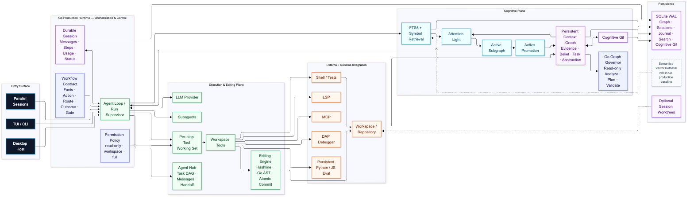

<p align="center">
  
</p>

<h1 align="center">LumenCortex</h1>

<p align="center"><strong>Cognitive Coding Agent Harness</strong></p>

**English** | [简体中文](README.zh-CN.md)

LumenCortex is a cognitive coding-agent system for long-running software tasks. It combines evidence-oriented memory, bounded attention, controlled agent execution, repository editing, debugging, evaluation, and workflow verification.

LumenCortex is a coding-agent harness with its own cognitive architecture. It is not tied to one model provider and is not a copy of another agent framework.

> Graph is Memory. Light is Attention. Decision is Judgment. Think is Deliberation. Agent is Execution.

<p align="center">
  
</p>

[Open the full-size architecture diagram](docs/assets/architecture/system-architecture.png).

## Current source and release baseline

Snapshot: **2026-11-12**. Core main is `883c63e`; the Go runtime code baseline remains `208ad6b`. Source commits, runtime identity, release tags, and Desktop dependencies are separate version surfaces.

| Surface | Current baseline |
|---|---|
| Go runtime code baseline | `208ad6b` — Agent Harness Core integrated into `main`. |
| Latest Core release tag | `v0.1.4` at `42ee234`; older than current `main`. |
| Go Engine identity | `0.1.4-preview` (`runtime.GoRuntimePreviewVersion`); this is not a new Git release tag. |
| Desktop `main` | `4a6c2f3`. |
| Desktop Core dependency | `v0.1.4`; Desktop has not yet been upgraded to a release containing Core `208ad6b`. |
| Legacy Node package metadata | `0.6.0`; retained as historical reference, not the production runtime. |

The Go runtime code baseline `208ad6b` is newer than `v0.1.4` and has not yet received a new SemVer tag. Subsequent documentation-only commits do not change that code baseline. Do not treat the `v0.1.4` module as equivalent to current `main`. Desktop must move to an exact new Core release before its corresponding release.

## Runtime policy: Go only

**Go is the sole production runtime for LumenCortex.** New runtime behavior, production integrations, and acceptance evidence belong to the Go implementation.

The Node.js source and package remain in the repository as historical, read-only reference material. They are not a second maintained production runtime, a feature-parity target, or an authority for current production behavior. Node.js tests do not establish that Go behavior is correct.

The Go Engine is the production runtime implementation. `cmd/lcx-go` is the current source-run CLI/host entrypoint; its command surface is still identified by the program as a preview CLI and should not be confused with a separately packaged release binary.

## Core capabilities

The current Core `main` carries the Go Agent Harness code baseline `208ad6b`.

### Agent execution and workflow

- Multi-turn Agent execution, provider adapters, persistent Sessions, resume, cancellation, and run supervision.
- Workspace file reading, search, writing, exact replacement, and validated multi-file patches.
- Workflow Contracts with Facts, Actions, Routes, Outcomes, Gates, approval, and delivery verification.
- Tool permissions, workspace trust, bounded shell output, and managed process lifecycle.
- MCP over stdio and HTTP, LSP navigation, diagnostics and guarded symbol rename, Skills, Subagents, and parallel Sessions.

### Editing and code intelligence

- A shared revision-aware Editing Engine for file mutations.
- Hashline anchors, stale-revision rejection, compare-and-swap writes, write leases, and atomic multi-file application.
- Go AST-aware structural editing and scope-aware symbol rename. AST editing is currently Go-specific; other languages use their available LSP navigation and guarded rename capabilities; Go Code Actions are not yet implemented.

### Debugging and evaluation

- DAP-based debug sessions with adapter lifecycle, stop-epoch validation, stack/frame inspection, and controlled execution.
- Persistent Python and JavaScript Eval kernels, artifact transfer, session isolation, and managed process cleanup.
- Agent Hub task state, worker messaging, pause/cancel controls, handoff, and lease-aware ownership.

Platform limits remain explicit: Linux real-adapter DAP and host/VM cgroup/UID Broker acceptance are not established by container tests; native interactive Wails acceptance is a separate Desktop release gate. macOS RSS supervision is not a hard memory limit. JavaScript forced interruption may discard the worker and its in-memory state. See the linked design and release-gate documents for exact boundaries.

### Cognitive runtime

- Persistent Context Graph, Notes/Recall and Attention Light foundations.
- Go Graph Governor read-only Analyze / Plan / Validate against the shared SQLite graph.
- The model Curator path fails closed until request-envelope admission is available; Go main does not claim graph Apply or Cortex Epoch execution.
- The expanded Cognitive Core work adds richer Scope / Time / Evidence and Experimental Experience mechanisms, but the final Astra/Fable/Gemini candidates remain separate from this `main` snapshot. Do not count their candidate-only capabilities as current main behavior.
- The seven-domain cognitive architecture, capability/evidence matrix, memory lifecycle and roadmap are documented in [Cognitive Core](docs/cognitive-core/README.md).

### Extension points

LumenCortex supports MCP servers, Skills, and a host-supplied Go Plugin API. The Plugin API is an extension interface, not a public plugin marketplace.

## Build and try the Go CLI

Requirements:

- Go 1.23 or newer.
- A C toolchain when building SQLite-backed packages with CGO enabled.

From the Core repository:

```bash
go run ./cmd/lcx-go health
go run ./cmd/lcx-go sessions
go run ./cmd/lcx-go agent "inspect this repository and fix the failing tests"
```

The Agent command requires a configured Go provider/model. Provider configuration is documented in [Go provider configuration](docs/go-provider.md). The CLI identifies its current command surface as a preview; Core `main` itself is not a new SemVer release.

## Development and validation

Use Go tests and Go runtime evidence for production acceptance:

```bash
go test ./...
go vet ./...
```

`npm test` and other Node.js scripts exercise retained historical reference code only. They are not substitutes for Go tests and must not be used as Go production acceptance evidence. Node.js 22.13+ is needed only if a developer explicitly runs those legacy reference tools/tests or regenerates the Mermaid documentation diagrams; it is not a production runtime requirement.

## Documentation

Start with the [documentation index](docs/README.md).

- [Cognitive Core overview (English)](docs/cognitive-core/README.md) · [中文](docs/cognitive-core/README.zh-CN.md)
- [Cognitive architecture (English)](docs/cognitive-core/architecture.md) · [中文](docs/cognitive-core/architecture.zh-CN.md)
- [Capability matrix (English)](docs/cognitive-core/capabilities.md) · [中文](docs/cognitive-core/capabilities.zh-CN.md)
- [Memory lifecycle (English)](docs/cognitive-core/memory-lifecycle.md) · [中文](docs/cognitive-core/memory-lifecycle.zh-CN.md)
- [Cognitive roadmap (English)](docs/cognitive-core/roadmap.md) · [中文](docs/cognitive-core/roadmap.zh-CN.md)
- [Agent Harness overview (English)](docs/harness/README.md) · [中文](docs/harness/README.zh-CN.md)
- [Harness capabilities (English)](docs/harness/capabilities.md) · [中文](docs/harness/capabilities.zh-CN.md)
- [Harness roadmap (English)](docs/harness/roadmap.md) · [中文](docs/harness/roadmap.zh-CN.md)

- [System overview](docs/system-overview.md)
- [Architecture diagrams](docs/architecture-diagrams.md)
- [Agent execution flow](docs/execution-flow.md)
- [Agent runtime](docs/agent-runtime.md)
- [Hashline and AST editing](docs/reports/harness-evolution-editing-20261110.md)
- [DAP debugger](docs/dap-debugger.md)
- [Persistent Eval](docs/persistent-eval.md)
- [Agent Hub](docs/agent-hub.md)
- [Workflow Contract](docs/workflow-contract.md)
- [Security and trust](docs/security-and-trust.md)
- [Validation evidence](docs/validation.md)
- [Standalone readiness and known gaps](docs/standalone-readiness.md)
- [Go production runtime and migration history](docs/go-runtime-migration.md)
- [Go provider configuration](docs/go-provider.md)
- [Plugin and MCP templates](docs/plugins-mcp-templates.md)
- [Architecture Decision Records](docs/adr/README.md) · [中文](docs/adr/README.zh-CN.md)
- [Implementation principles](docs/implementation-principles.md) · [中文](docs/implementation-principles.zh-CN.md)
- [Implementation and review reports](docs/reports/README.md) · [中文](docs/reports/README.zh-CN.md)

## Current release boundaries

- The Go runtime code baseline in Core `main` is `208ad6b`; the latest published Core tag remains `v0.1.4`.
- Desktop remains pinned to Core `v0.1.4`; exact dependency upgrade and native Wails acceptance are pending.
- Linux DAP, cgroup, and UID Broker host/VM acceptance remain platform gates if Linux support is claimed.
- The expanded Cognitive Core candidate is not part of this `main` snapshot; see [Cognitive Core status](docs/cognitive-core/README.md).
- Harness Evolution follow-up work and Desktop-specific acceptance must be checked against their exact branch, Core tag and Desktop dependency; see [Harness status](docs/harness/README.md).
- Vision/browser automation, whole-run rollback of arbitrary local-session shell mutations, and production-calibrated autonomous cognitive governance are not claimed.

## License

MIT
