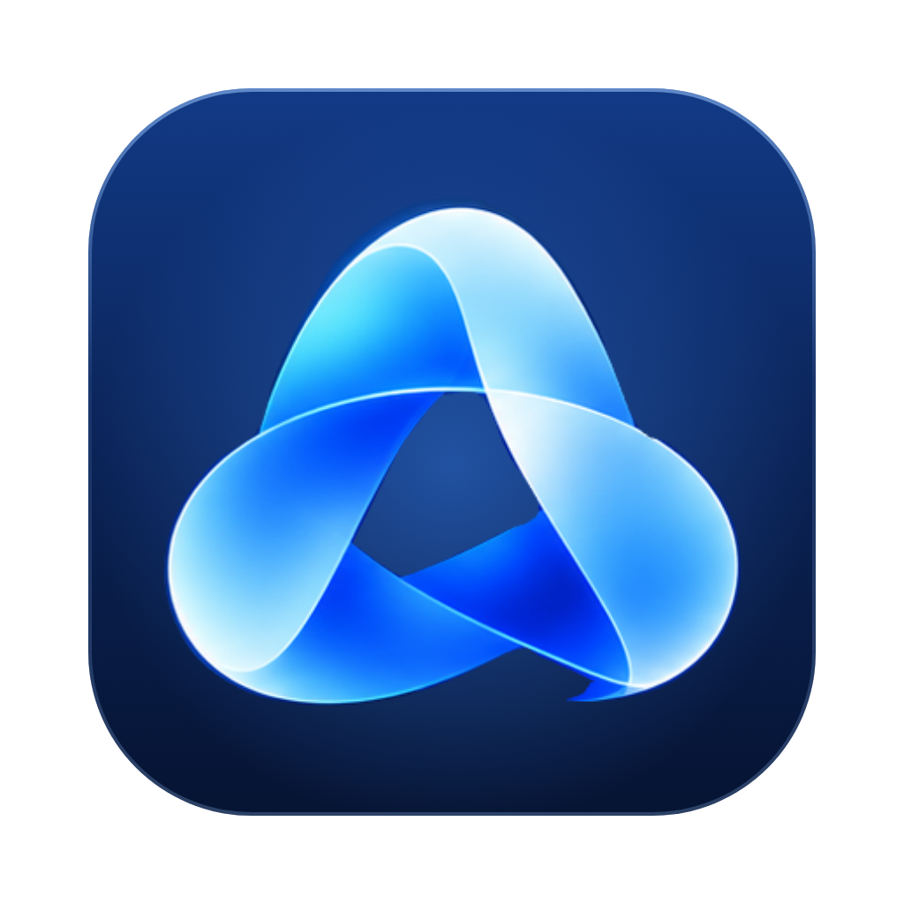
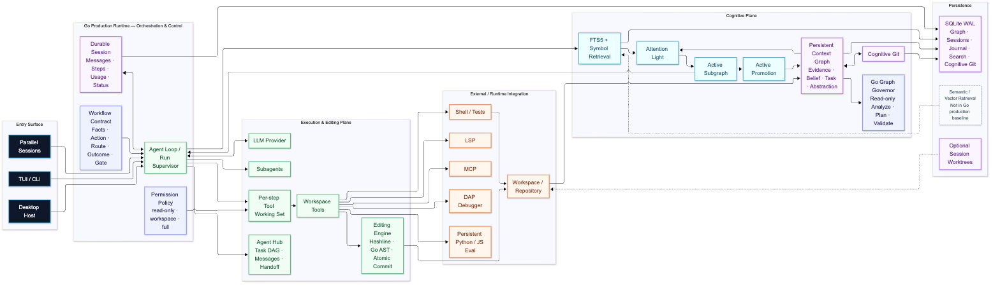

<p align="center">
  
</p>

<h1 align="center">LumenCortex</h1>

<p align="center"><strong>认知型编程 Agent Harness</strong></p>

[English](README.md) | **简体中文**

LumenCortex 是面向长周期软件开发任务的认知型编程 Agent 系统，结合证据驱动的记忆、有界注意力、受控 Agent 执行、代码编辑、调试、评估和工作流验证。

LumenCortex 是拥有自身认知架构的 Coding Agent Harness，不绑定单一模型供应商，也不是对其他 Agent 框架的简单复刻。

> Graph is Memory. Light is Attention. Decision is Judgment. Think is Deliberation. Agent is Execution.
>
> 图是记忆，Light 是注意力，Decision 是判断，Think 是深度推理，Agent 是执行。

<p align="center">
  
</p>

[查看完整尺寸的系统架构图](docs/assets/architecture/system-architecture.png)。

## 当前源码与发布基线

快照：**2026-11-12**。Core main 为 `883c63e`，Go Runtime 代码基线仍为 `208ad6b`。源码提交、Runtime 标识、Release Tag 和 Desktop 依赖属于不同版本维度。

| 范围 | 当前基线 |
|---|---|
| Go Runtime 代码基线 | `208ad6b`，Agent Harness Core 已合入 `main`。 |
| 最新 Core Release Tag | `v0.1.4`，Commit `42ee234`，早于当前 `main`。 |
| Go Engine 标识 | `0.1.4-preview`（`runtime.GoRuntimePreviewVersion`），这不是新的 Git Release Tag。 |
| Desktop `main` | `4a6c2f3`。 |
| Desktop Core 依赖 | `v0.1.4`，尚未升级到包含 Core `208ad6b` 的新 Release。 |
| 历史 Node 包元数据 | `0.6.0`，仅保留为历史参考，不是生产 Runtime。 |

Go Runtime 代码基线 `208ad6b` 新于 `v0.1.4`，目前尚未打新的 SemVer Tag；后续纯文档提交不会改变该代码基线。不能把 `v0.1.4` 模块等同于当前 `main`。Desktop 必须在 Core 发布新的精确版本后再升级依赖。

## Runtime 决策：只使用 Go

**Go 是 LumenCortex 唯一正式生产 Runtime。** 新的 Runtime 行为、生产集成和正式验收证据都必须以 Go 实现为准。

仓库中的 Node.js 源码和 package 仅作为历史只读参考保留，不是第二套持续维护的生产 Runtime，不是 Node/Go 功能对齐目标，也不再拥有当前生产行为的决定权。Node.js 测试不能证明 Go 实现正确。

Go Engine 是正式生产 Runtime 实现。`cmd/lcx-go` 是当前从源码运行的 CLI/Host 入口；程序自身仍将其命令面标记为 preview CLI，不能将它误认为已经单独打包发布的正式二进制。

## Core 当前能力

当前 Core `main` 包含 `208ad6b` 的 Go Agent Harness 代码基线。

### Agent 执行与工作流

- 多轮 Agent 执行、Provider Adapter、持久化 Session、恢复、取消和 Run 生命周期管理。
- Workspace 文件读取、搜索、写入、精确替换和经过校验的多文件 Patch。
- Workflow Contract：Facts、Actions、Routes、Outcomes、Gates、审批和交付验证。
- 工具权限、Workspace Trust、有界 Shell 输出和托管进程生命周期。
- 支持 stdio / HTTP 的 MCP、LSP 导航、诊断与受保护的符号 Rename、Skills、Subagents 和并行 Session。

### 编辑与代码智能

- 统一的、基于 Revision 的 Editing Engine。
- Hashline 锚点、过期 Revision 拒绝、Compare-and-Swap 写入、Write Lease 和原子多文件应用。
- Go AST 结构化编辑和作用域感知符号 Rename。目前 AST 编辑仅针对 Go；其他语言使用已有的 LSP 导航和受保护 Rename。Go 版 LSP Code Actions 尚未实现。

### 调试与 Eval

- 基于 DAP 的 Debug Session，支持 Adapter 生命周期、Stop Epoch 校验、调用栈/变量检查和受控执行。
- 持久化 Python / JavaScript Eval Kernel、Artifact 传递、Session 隔离和托管进程清理。
- Agent Hub 任务状态、Worker 消息、Pause / Cancel、Handoff 和基于 Lease 的所有权管理。

平台限制必须明确：容器测试不能证明 Linux 真实 DAP Adapter、主机/VM cgroup 和 UID Broker 已验收；原生交互式 Wails 验收属于 Desktop 单独的发布门禁。macOS RSS 监督不是硬内存限制。JavaScript 强制中断可能丢弃 Worker 及其内存状态。具体边界见对应设计和发布门禁文档。

### 认知运行时

- 持久化 Context Graph、Notes/Recall 和 Attention Light 基础能力。
- Go Graph Governor 基于共享 SQLite Graph 提供只读 Analyze / Plan / Validate。
- 在 Request Envelope Admission 完整之前，模型 Curator 路径必须 fail-closed；Go main 不声明 Graph Apply 或 Cortex Epoch 执行能力。
- 扩展的 Cognitive Core 工作增加了更丰富的 Scope / Time / Evidence 和 Experimental Experience 机制，但 Astra/Fable/Gemini 最终候选仍与当前 main 分离。候选能力不能算作当前 main 已有能力。
- 七大认知领域、能力与证据矩阵、记忆生命周期和演进路线见 [Cognitive Core 文档](docs/cognitive-core/README.md)。

### 扩展接口

LumenCortex 支持 MCP Server、Skills，以及由宿主程序提供的 Go Plugin API。Plugin API 是扩展接口，不是面向公众的插件市场。

## 构建与运行 Go CLI

环境要求：

- Go 1.23 或更高版本。
- 使用 CGO 构建 SQLite 相关包时需要 C 工具链。

在 Core 仓库中执行：

```bash
go run ./cmd/lcx-go health
go run ./cmd/lcx-go sessions
go run ./cmd/lcx-go agent "检查当前仓库并修复失败的测试"
```

Agent 命令需要先配置 Go Provider / Model，见 [Go Provider 配置](docs/go-provider.md)。当前 CLI 自身将命令面标记为 preview；Core `main` 也尚未对应新的 SemVer Release。

## 开发与验证

正式生产验收使用 Go 测试和 Go Runtime 证据：

```bash
go test ./...
go vet ./...
```

`npm test` 和其他 Node.js 脚本只用于保留的历史参考代码，不能替代 Go 测试，也不能作为 Go 生产实现的验收证据。只有开发者明确运行这些历史参考工具/测试或重新生成 Mermaid 架构图时才需要 Node.js 22.13+；它不是生产 Runtime 的依赖。

## 文档

建议从[中文文档目录](docs/README.zh-CN.md)开始；[English documentation index](docs/README.md)。

常用文档：[Agent Runtime](docs/agent-runtime.zh-CN.md) · [Agent Hub](docs/agent-hub.zh-CN.md) · [DAP 调试](docs/dap-debugger.zh-CN.md) · [持久化 Eval](docs/persistent-eval.zh-CN.md) · [安全与信任](docs/security-and-trust.zh-CN.md) · [Cognitive Core](docs/cognitive-core/README.zh-CN.md)。

- [Cognitive Core 总览](docs/cognitive-core/README.zh-CN.md)
- [Cognitive Core 总体架构](docs/cognitive-core/architecture.zh-CN.md)
- [认知能力现状](docs/cognitive-core/capabilities.zh-CN.md)
- [记忆管理：短期、长期、压缩和保留](docs/cognitive-core/memory-lifecycle.zh-CN.md)
- [Cognitive Core 后续工作](docs/cognitive-core/roadmap.zh-CN.md)
- [Agent Harness 总览](docs/harness/README.zh-CN.md)
- [Agent Harness 能力清单](docs/harness/capabilities.zh-CN.md)
- [Agent Harness 后续改进方向](docs/harness/roadmap.zh-CN.md)

- [系统概览](docs/system-overview.md)
- [架构图](docs/architecture-diagrams.md)
- [Agent 执行流程](docs/execution-flow.md)
- [Agent Runtime](docs/agent-runtime.md)
- [Hashline 与 AST 编辑](docs/reports/harness-evolution-editing-20261110.md)
- [DAP 调试器](docs/dap-debugger.md)
- [持久化 Eval](docs/persistent-eval.md)
- [Agent Hub](docs/agent-hub.md)
- [Workflow Contract](docs/workflow-contract.md)
- [安全与信任边界](docs/security-and-trust.md)
- [验证证据](docs/validation.md)
- [独立 Agent 就绪度与已知差距](docs/standalone-readiness.md)
- [Go 生产 Runtime 与迁移历史](docs/go-runtime-migration.md)
- [Go Provider 配置](docs/go-provider.md)
- [Plugin 与 MCP 模板](docs/plugins-mcp-templates.md)
- [架构决策记录](docs/adr/README.md)

## 当前发布边界

- Core `main` 中的 Go Runtime 代码基线为 `208ad6b`；仓库最新已发布 Core Tag 仍是 `v0.1.4`。
- Desktop 仍固定依赖 Core `v0.1.4`；精确依赖升级和原生 Wails 验收尚未完成。
- 如果声明 Linux 支持，仍需完成 Linux DAP、cgroup 和 UID Broker 主机/VM 验收。
- 扩展 Cognitive Core 候选尚未进入当前 `main`，见 [Cognitive Core 状态](docs/cognitive-core/README.md)。
- Harness Evolution 后续工作和 Desktop 验收必须按准确分支、Core Tag 和 Desktop 依赖判断，见 [Harness 状态](docs/harness/README.md)。
- 不宣称已提供 Vision/Browser 自动化、本地 Session 任意 Shell 变更的全流程回滚，或生产级自主认知治理。

## License

MIT
