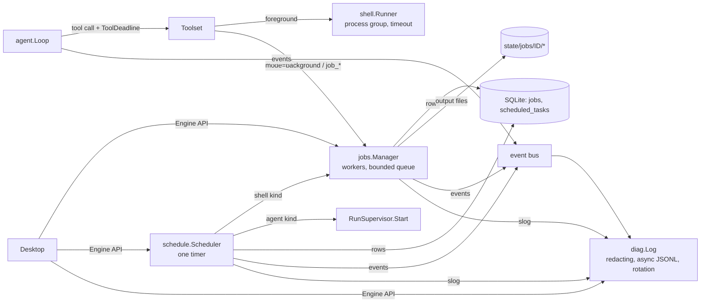
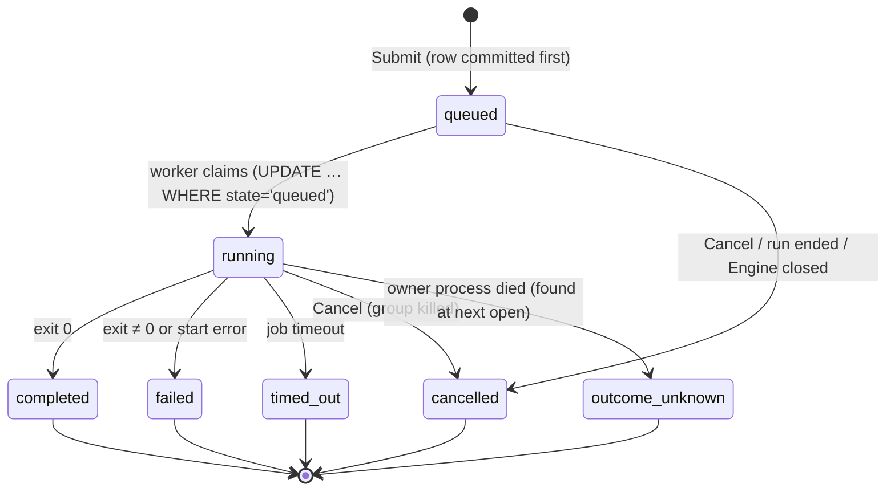

# ADR-0019: Execution runtime — tool timeouts, run deadlines, background jobs, timers, diagnostics (schema v8)

- **Status:** Proposed (implemented on `rt/execution-runtime`)
- **Date:** 2026-11-01
- **Owners:** project maintainers
- **Supersedes:** none
- **Superseded by:** none

## Context

A run executes its tool calls one at a time, and the `shell` tool waits for its command to exit with no
timeout of its own (`internal/shell.Runner.Run` stops only on cancellation). Nothing tells a run how much
time it has: in TB2 W13 runs spent their budget inside one command or in exploration and were killed by
the harness (`AgentTimeoutError`) without delivering. There is no way to start a long build or test and keep
working, no durable record of commands that outlive one tool call, no timers, and the only trace is the
SQLite `journal` table (content-free by projection) plus the lossy in-process event bus.

This ADR adds the smallest set of runtime capabilities that closes those gaps, reusing what exists: the
shell runner and its process groups, the session store and its migration runner, the event bus, the
journal's content policy, `RunSupervisor`, and the configuration loader.

## Decision

### Overview

Packages: `internal/jobs` (queue and workers), `internal/schedule` (timers), `internal/diag` (diagnostics
log). SQL stays in `internal/session` (`jobs.go`, `schedules.go`), as for every other table. The runtime
binds them in `runtime/jobs.go`, `runtime/schedules.go`, `runtime/diagnostics.go`. Limits come from the
global configuration's `execution` object (`config.Execution`, global file only, like `concurrency`).

### 1. Foreground tool timeout (RUNTIME-001)

`shell` takes `timeout_sec` (1…86400). The effective timeout is the smallest of `timeout_sec`,
`execution.shellTimeoutSeconds` (absent: none) and the time left before the call's tool deadline (§2).
At the timeout the runner sends SIGTERM to the command's process group, waits a 2 s grace, then SIGKILL; the
pipes are closed after the existing 2 s wait delay, so no orphaned process keeps the call open. The result
keeps the partial stdout/stderr (head and tail) and reports `timedOut: true`, `timeoutSec`, exit code -1,
and an error text telling the model that the group was terminated and the command's effects are unknown.
A timeout is a tool result, not a run exit; cancellation of the run stays a run exit (`cancelled`), so the
two are distinguishable. The execution record of the call (ADR-0018) ends `outcome_unknown` for a timed-out
command: it may have changed the workspace.

### 2. Run deadline (RUNTIME-001)

`AgentOptions.Deadline` (absolute time; CLI `LCX_DEADLINE` as a Go duration from process start or RFC 3339)
and `AgentOptions.DeadlineReserve` (default: a tenth of the budget, clamped to 30 s…120 s). The loop:

- passes every tool call a `protocol.WithToolDeadline(ctx, deadline - reserve)`; tools bound their own
  waits by it (foreground shell, `job_wait`), so no tool can consume the reserve;
- appends `deadline: {remainingSec}` to each tool result's JSON content (results are new transcript rows,
  so the cached prefix is not disturbed: no dynamic text enters the fixed system prompt);
- appends one user row (origin `deadline`) when a run with a deadline starts, stating its budget, and one
  when the remaining time first falls under the reserve, asking the model to stop exploring and deliver;
- ends the run `interrupted` with kind `deadline` when the deadline passes (a request or tool in flight is
  cancelled). External cancellation keeps kind `cancelled`.

No deadline: behaviour is unchanged.

### 3. Background jobs and the durable queue (RUNTIME-002/003)

`shell` takes `mode: "foreground" | "background"`. A background call submits a job and returns at once with
its id. Tools `job_status`, `job_wait`, `job_cancel`, `job_list` act on the jobs of the run's session. All
are `exec` permission (registered only where `shell` is). `job_wait` blocks without model calls until one of
the named jobs (or any active job of the run) ends or its timeout / the tool deadline passes.

- Every transition is one `UPDATE … WHERE job_id = ? AND state = ?` (compare-and-set): two writers never
  both move a job.
- `runner_id`/`runner_pid` name the owning manager. At open, a manager adopts queued jobs of runners whose
  process is gone and marks their running jobs `outcome_unknown`; such a job is never re-run automatically.
- Workers: `execution.maxConcurrentJobs` (default 2). Queue: `execution.maxQueuedJobs` (default 32); a
  submission beyond it is refused with a clear error, never dropped. At most 8 active jobs per run.
- Output: per stream at most `execution.jobOutputBytes` on disk (head + tail, middle cut) under
  `<state>/jobs/<job_id>/`, bounded memory per job, readable while the job runs. The database holds byte
  counts only. Retention: finished jobs older than `execution.jobRetentionDays` are deleted with their
  files; files whose row is gone (a deleted session) are removed.
- A run's active jobs: the completion gate refuses a final answer while the run still has queued or running
  jobs (correction: wait, read or cancel them). When a run ends any other way, its active jobs are cancelled
  (reason `run_ended`): no job outlives the run that wanted it unobserved. Host and schedule jobs are not
  tied to a run. Engine close cancels the jobs it runs.
- Events: `job.state` `{jobId, sessionId, runId, scheduleId, source, state, exitCode}`.

### 4. Timers and scheduled tasks (RUNTIME-004)

In-run delays use `job_wait` (bounded, cancellable, no model calls). Durable scheduled tasks live in
`scheduled_tasks`: kind `shell` (submits a job, source `schedule`) or `agent` (starts a run on a session with
a prompt and an explicit policy, default read-only, via the host's `RunSupervisor`); trigger `once` (at a
time), `interval` (every N ≥ 60 s) or `cron` (a standard five-field expression, `*`, lists, ranges and
steps, read in an explicit IANA `timezone` — `UTC` unless the task names one; a local time the
spring-forward gap skips does not fire, and a wall time the fall-back hour repeats fires once);
`missed_policy` `skip` (default) or `run_once`. The expression and zone are columns of the row
(`cron_expr`, `timezone`), so a task means the same thing after a restart and in another process.

- One scheduler goroutine per Engine with one `time.Timer` set to the earliest due task; no per-task timers.
- A firing is claimed by `UPDATE … SET next_run_at = <next> WHERE schedule_id = ? AND next_run_at = <read>`:
  two Engines on one database never fire the same occurrence twice.
- Overlap: when the previous firing's job or run is still active, the occurrence is skipped
  (`skipped_overlap`), never run concurrently.
- An agent task fires only in a process with a `RunSupervisor`; otherwise it stays due.
- A task whose stored trigger yields no further slot (a corrupted expression, an unknown zone) is
  disabled with `last_status = failed` and the reason in `last_error`, so it cannot fail on every tick.
- An agent may schedule its own continuation: the tools `wakeup_schedule {delay_sec, message}` and
  `wakeup_cancel {wakeup_id}` create and remove a one-shot `agent` task on the calling session with the
  calling run's policy as its ceiling, at most three pending per session. Both are `write` tools (they
  schedule future work) and exist only in a thread's run whose runtime bound a controller: a child run's
  lifecycle belongs to its parent, so a subagent or an execution task gets neither tool.
- Events: `schedule.changed`, `schedule.fired`.

### 5. Diagnostics log (OBS-001)

`internal/diag` writes JSON Lines to `<state>/logs/` through `log/slog`: an asynchronous, bounded queue
(a full queue drops the record and counts it; the agent path never waits on log I/O), size rotation (8 MiB
× 5 files) and 14-day retention. Level from `execution.logLevel`. The runtime feeds it the event bus
(lossy by design: durable state stays in SQLite) plus direct records from the job manager and scheduler.

Correlation fields, used where they apply: `session_id`, `run_id`, `step`, `tool_call_id`, `job_id`,
`schedule_id`, `provider`, `model`, `duration_ms`, `error_code`.

Redaction applies at every level, before a record is queued: secret-named keys (authorization, cookie,
api key, token, secret, password, credential, private key) are replaced; secret-shaped values (bearer
tokens, `sk-…`, GitHub/AWS keys, PEM blocks) are masked inside any string; content fields (prompts,
messages, reasoning, tool output, tool arguments, commands) are reduced to their byte length, except that
`debug` keeps a command or argument text truncated to 512 bytes after masking. Reasoning and tool output are
never logged. Export writes a zip of the (already redacted) logs, a manifest and job/schedule summaries
without commands or payloads.

### Engine API (consumed by Desktop)

`Jobs`, `Job`, `JobOutput`, `SubmitJob`, `CancelJob`; `Schedules`, `CreateSchedule`, `UpdateSchedule`,
`DeleteSchedule`; `DiagnosticLogs`, `DiagnosticStats`, `ExportDiagnostics`. JSON field names are camelCase.

## Consequences

- Schema v8 (`0007_jobs`, `0008_schedules`, both reversible). A v6 binary refuses a v8 database
  (`ErrSchemaTooNew`); `lcx-go db downgrade --to 6` drops jobs and schedules after a backup.
- Session deletion removes the session's jobs and scheduled tasks (`purgeTables`, cascade); the job manager
  removes the orphaned output files.
- Background commands run concurrently with the run's foreground tools in the same workspace. The loop still
  executes tool calls one at a time; conflicting background commands are the model's responsibility, bounded
  by the per-run job limit.
- No new process, service or database. Memory: bounded queue and output buffers per job, one scheduler
  timer, one log writer goroutine.

## Alternatives considered

- A separate jobs database: avoids touching the session schema but splits deletion and backup; rejected.
- Logging through the journal table: synchronous SQLite writes on the agent path and no rotation; the
  journal stays the content-free durable trace and the diagnostics log is the bounded, lossy companion.
- Cron expressions: no current need; `once` and `interval` cover delayed checks and periodic tasks.
