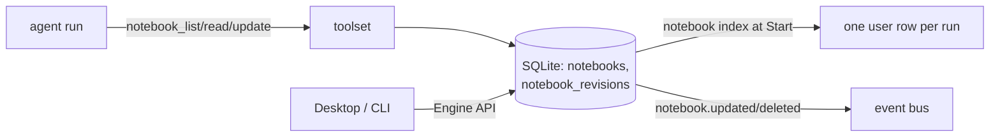

# ADR-0020: The agent's working notebook

- **Status:** Proposed (implemented on `rt/notebook`)
- **Date:** 2026-11-01
- **Owners:** project maintainers
- **Supersedes:** none
- **Superseded by:** none

## Context

A long run keeps its durable state in the Task State (work units, checks, notes, workflow), and the
transcript is compacted to a window. Neither is a place for the working material a careful engineer
keeps beside the task: the plan as it is being made, a checklist, the findings of an exploration, the
experiments tried, the decisions taken and why, the failures, the verification evidence, and the
handoff for whoever continues. Today that material either lands in the transcript (and disappears
with the window), in a file in the workspace (which the user did not ask for, and which the run then
owns as a change), or nowhere.

What is missing is *external working memory*: a durable, readable, editable document the agent
maintains for itself, that the user can inspect, that survives a context reset, a resume and a model
switch, and that a subagent can hand to its parent.

## Decision

A **notebook** is a Markdown document owned by one session. It is external working memory, not a
second Task State.

### 1. Shape and storage

A notebook is a Markdown body with `# ` title and `## ` sections. The conventional sections are
Plan, Checklist, Findings, Experiments, Decisions, Failures, Verification and Handoff; they are a
convention the model follows, not a schema the runtime enforces. `internal/notebook` holds the pure
Markdown operations (split on `## ` headings outside fenced code blocks, read one section, replace or
append a section, append a block, extract `- [ ]`/`- [x]` items, list headings); it has no storage and
no policy.

Rows live in the workspace database (`internal/session/notebooks.go`), following ADR-0016: the
notebook is state, so it lives in the state database and not in the workspace, and the file tools
cannot reach it.

- `notebooks(id, session_id, title, body, version, created_at, updated_at, updated_by)` with
  `UNIQUE(session_id, title)`; a session's notebooks are deleted with it.
- `notebook_revisions(notebook_id, version, body, op, updated_by, created_at)`, primary key
  `(notebook_id, version)`; `op` is `create`, `replace`, `append` or `section`.

Schema v9 (`0009_notebooks`), reversible; session deletion purges both tables (`purgeTables`).

Limits are constants, not configuration, because a notebook is a note and not a second database:

| Limit | Value | Behaviour past it |
|---|---|---|
| body | 256 KiB | the write is refused with its size and the limit |
| title | 1…120 characters, one printable line | refused |
| notebooks per session | 32 | refused, naming the limit |
| revisions kept per notebook | 50 | the oldest are pruned in the same transaction as the write |

### 2. Boundaries: not Task State, not the completion gate

- The runtime never reads a notebook to decide anything: no status transition, no completion-gate
  decision, no check result, no job state and no work-unit state depends on it. A run that never
  touches a notebook is complete exactly as before.
- A notebook cannot declare a check passed. Check results come from the evaluator (ADR-0017); a
  notebook may quote them, and the quote is the model's text.
- Notebooks are not the thread's notes (`note_write`/recall, ADR-0010): notes are the thread's
  curated, freshness-checked memory shared across runs and sessions; a notebook is the run's working
  material for one task. Neither replaces the other and neither is merged into the other
  automatically.
- A notebook is never the system prompt and never injected in full: the context carries one short
  index row per run (§5), and bodies are read with a tool.

### 3. Tools and permission

Registered only when `toolset.Options.Notebook` is bound, which the runtime does for every run:

| Tool | Arguments | Result |
|---|---|---|
| `notebook_list` | `{}`, optional `session_id` (a direct child) | titles, ids, versions, sizes, update times, updaters, section headings |
| `notebook_read` | `notebook` (title or id), optional `section`, optional `session_id` | the body, or only that section |
| `notebook_update` | `notebook`, `op` (`create`/`replace`/`append`/`section`), `content`, optional `section`, optional `expected_version` | the new version and size |

They carry the permission value `state`: they write only the run's own durable state, never a
workspace file, never a command, never another session. `policyAllows` admits `state` under every
policy, the read-only one included, because a read-only run may still keep notes for itself; the
tools that change anything else stay filtered exactly as before. A call is never `mutatesWorkspace`,
so a notebook write does not open a new completion obligation.

The model-visible result of a refused write is a result, not a failed call: `{"error": …}`, with
`currentVersion` when the refusal is a conflict.

These tools see and write **working notebooks only**. An execution notebook — the notebook runtime's
cells, outputs and durable history, stored under the reserved title prefix `Execution notebook: ` — is
never listed, read, replaced, appended to or created here, under every policy: its cells are the code
a user runs and its outputs are the evidence of what ran, so a model that could write one could plant
code and show results that never happened. `create` refuses the reserved prefix; a `replace`, `append`
or `section` whose target is an execution notebook is refused before the write. The host's
working-notebook API enforces the same boundary (`runtime.ErrNotebookKind`) rather than relying on a
host UI to hide the path.

### 4. Concurrency and conflicts

Every write is a compare-and-set inside one short write transaction:

- `create` needs no version and fails when the session already holds that title.
- `replace` requires `expected_version`; a mismatch writes nothing and returns the current version.
- `append` and `section` take `expected_version` when given, and otherwise apply to the version the
  transaction read, so two concurrent appends both land, each on its own version.
- A write whose body would exceed the limit is refused before the row changes.

A conflict is `session.NotebookConflict` (wrapped by the runtime as `*runtime.NotebookConflict`,
`errors.Is(err, runtime.ErrNotebookConflict)`) carrying `CurrentVersion`; the tool result tells the
model to re-read and retry. Revisions are written in the same transaction, so the version history
never disagrees with the body.

### 5. Context index

When a run starts and its session has working notebooks, the Start transaction appends exactly one user row
(origin `notebook`) listing at most 8 notebooks as `title (vN, updated <rfc3339>, sections: A, B)`,
capped at 600 bytes, plus one sentence telling the model to read a Handoff section with
`notebook_read` before continuing. Never a body, and never an execution notebook: the row only names
notebooks the tools can read. A session without working notebooks gets no row, so an ordinary run's
request is byte-for-byte what it was before this ADR.

The row is a transcript row and not system-prompt text: the cached prefix is untouched, and the row is
readable after a context reset (it is written by the next Start) and after a model switch.

### 6. Subagents and the host

- A subagent run is a session: it gets its own notebooks, its own index row and its own writer.
- A run reads its own notebooks and those of its **direct children** (the `session_relations` edge);
  any other session id is refused with a result that says so. Writes always name the run's own
  session: a parent merges a child's notebook by reading it and writing its own, which keeps one
  writer per notebook and leaves the child's record as the child left it.
- A read of a child is a session-source read, as `read_thread` is (ADR-0018): the `notebook_list` or
  `notebook_read` result names the child (`"session"`), its tool row stores an edge deriving from the
  child, so revoking the child fences the reader, and a privacy deletion of the child removes the
  copy. A child withdrawn as a source (revoked or deleted) reads as `{"session", "withdrawn": true}`
  with nothing of it, and the row cites nothing.
- The host (Desktop, CLI) uses the Engine API: `Notebooks`, `Notebook`, `CreateNotebook`,
  `SaveNotebook` (`updated_by = "host"`), `NotebookRevisions`, `NotebookRevision`, `DeleteNotebook`,
  `ExportNotebook` (Markdown plus a file name). Host writes use the same compare-and-set. The reads of
  a session withdrawn as a source return the same entries marked `withdrawn`, with no title, section
  heading or body; `ExportNotebook` and `SaveNotebook` are refused with `ErrNotebookWithdrawn` (a save
  would replace a body the host was never shown; the store reads the fence inside the write, so a
  revocation between the host's read and its save refuses it too).
- `notebook.updated` and `notebook.deleted` carry `{notebookId, version, bytes}`; the journal records
  the same ids and counts and never a body.

### 7. Simple tasks

Nothing is created automatically. A run that does not need a notebook never gets one; the model is
encouraged to keep one for work that spans many steps, and the prompt layer says so through the
existing instruction files rather than a runtime rule.

## Consequences

- Schema v9; a v8 binary refuses a v9 database (`ErrSchemaTooNew`), and `lcx-go db downgrade --to 8`
  drops the notebook tables after a backup.
- Cost at the limits, measured (`TestNotebookStorageBytes`): 32 notebooks × 50 revisions × 8 KiB
  bodies = 12.5 MiB of bodies, **14,536,704 bytes** of database file. An ordinary notebook of a few
  KiB costs a page or two.
- The three tool specs add **1,907 bytes** as `protocol.ToolSpec` JSON and **1,937 bytes** as the
  OpenAI-compatible adapter sends them (`notebook_list` 422/432, `notebook_read` 557/567,
  `notebook_update` 928/938), against a tool list that already holds every built-in.
- The index row for 8 short-titled notebooks measures 585 bytes; longer titles list fewer notebooks
  and say how many were left out.
- No new process, service, database or dependency; reads and writes are single short transactions on
  the existing connection.

## Alternatives considered

- **A workspace file** (`NOTEBOOK.md`): visible to the model without a tool, but it is a change to the
  user's repository, it enters the diff and the completion gate, and two runs of one session would
  race on a file the file tools also guard. Rejected.
- **Task State entries**: would make the notebook part of the completion gate and the work-unit
  model, which is exactly the boundary this ADR keeps.
- **A todo tool with structured items**: too narrow for findings, decisions, experiments and
  verification; Markdown sections cover them with one format the user can read and edit.
- **Injecting the whole notebook every turn**: grows the request without bound and duplicates the
  transcript; the index row plus a read tool is the smallest thing that works after a reset.
