# Cognitive Core — Implementation (T5a and Go P0)

Current: unmerged completion candidate `feat/cognitive-core-final-completion-20261113`, based on main `00344b5` with committed historical `91af861` imported. [Completion report](../reports/cognitive-core-final-completion-2026-11-13.md) records tested source and review status. [中文实现说明](COGNITIVE_CORE_IMPLEMENTATION.zh-CN.md).
Historical stages below retain their original evidence scopes; current behavior is defined by the completion section, [ADR-0023](../adr/0023-unified-cognitive-lifecycle.md) and [architecture](architecture.md).
Related: [API](COGNITIVE_CORE_API.md) · [Data model](COGNITIVE_CORE_DATA_MODEL.md) · [Security](COGNITIVE_CORE_SECURITY.md) · [Test evidence](COGNITIVE_CORE_TEST_PLAN.md).

## Completion implementation (2026-11-13)

| Concern | Real Go path | Why it is shared |
|---|---|---|
| Scope/time/evidence | `internal/knowledge/{semantics,graph,lifecycle}.go`, `runtime/cognitive_graph.go` | Proposals, beliefs, experiences and dependencies use the same source/scope/CAS checks; confidence stays advisory. |
| Task attention | `runtime/knowledge.go`, `runtime/experience.go`, `internal/threadctx` | Existing lexical/CJK/camel-case tokenization; relevant bounded locators, not a new semantic database or truth score. |
| Evidence decisions | `runtime/cognitive_assessment.go`, `internal/session/cognitive_queries.go` | Current approved observations, exact dependency revisions and conflicting peers form an explicit decision; multi-evidence order never decides truth. |
| Proposal and action integration | `internal/toolset/cognitive.go`, `runtime/experience_execution.go`, `internal/agent/callback.go` | Existing Agent Loop binds identity and normal tool authority; five bounded tools do not grant host governance permission. |
| Actual application | `internal/session/{cognitive_completion,experience_actions}.go`, `internal/knowledge/application.go` | Pending admission commits before tools; exact original action digests bind durable execution IDs; no replay from stored strategy text. |
| Feedback and recovery | `runtime/experience_reuse.go`, terminal `preparedRun` and `Engine.Open` | Full settled failed actions can support checked counterexamples; unknown/partial/denied actions cannot. Memory errors remain separate from task result; restart never repeats tools. |
| Revision and retention | `runtime/cognitive_lifecycle.go`, `internal/session/cognitive_lifecycle.go` | Host-only source/owner/CAS lifecycle batches; protected counterexamples, dependency tracking, equivalent canonicalization and capacity pressure. |
| Privacy | Existing source fences/purge plus new record families | Reader-private Uses, telemetry and true decision exposure; no second deletion engine. |

The model supplies interpretation, proposed causes, conditions and action selection. Framework supplies observable source identity, evidence qualification, applicability, authority, revisions, persistence and recovery. A command matching the declared outcome establishes conditional mechanism use, not semantic explanation quality or causal task benefit.

The new records are migration 0017 in the same database. They do not create a second set of Session results: `eval_results` and `derived_origins` remain the check and execution authorities. The bounded application/decision records reference them. Existing opt-in `MaintainCognition` still consolidates semantic candidates through one lease and the same host-approved checks.

Read APIs never execute a command. Host proposals cannot set Evidence/VerifiedAt/fact. Governance cannot use frequency as correctness or archive protected evidence. An archived record may be restored only while source, dependency and validity remain current; invalidation and privacy fences are irreversible for the same identity. Exact-action reuse, eight Uses and existing byte limits are deliberate bounded semantics, not universal transfer.

The callback now observes each application action through the Loop's shared `observeWorkflow`, applies transition hooks, commits Task State with that action's execution and source edges, then recomputes effective tools. Human gates and denied transitions stop the sequence. `mode:"background"` is rejected before shell submission; Eval cannot gain this authority. The dispatcher returns its own exact execution ID/outcome, never a latest matching row. Transactional settlement checks ordered, distinct identities, session/run, argument digests and outcomes. Unknown actions remain recorded but cannot earn success or counterexample credit.

Nested retrieval uses ordinary result-source parsing before hook decoration. Its sources commit before the result is exposed and are unioned in the outer response; a newly consumed counterexample warning retains its aggregate-owner dependency. `read_thread` now includes bounded Experience locators in Attention, labelled `requires_condition_check`/`contested` rather than facts. Generic node writes cannot introduce or rewrite canonical aliases; withdrawing an alias preserves its historical pin even after its target advances or is withdrawn.

Workflow allowlists preserve their nil/empty distinction at the shared `EffectiveAllowlist`: nil adds no restriction; an explicit empty list denies every tool. The same result feeds ordinary step specs, application callbacks and prompt inspection, including after a persisted transition.

## 1. What the mechanism does

```mermaid
flowchart LR
  A[Top-level run ends completed/failed] -->|same writeTx as status| D[dirty_revision+1, maintenance_sources row]
  D --> L[MaintainCognition: AcquireMaintenanceLease]
  L --> B[fixBatch: version, dedupe, fences, privacy, whole-input 32 KiB cap]
  B --> M[maintenance session purpose=maintenance, derived from sources]
  M --> R[RunAgent: read-only policy, allowlist read_thread]
  R --> P[ParseOutput + Validate: untrusted JSON, no check ids]
  P --> V[host binding of the exact assertion → Core runs the bound check, closed episode]
  V --> C[CommitMaintenance: CAS lease/generation/cursor/policy + every source version]
  C --> I[Next top-level Start: assess, revalidate ≤2 bound checks/15 s for this run, index row of locators]
  I --> K[read_knowledge: claim, sources, cited paths, observations, applicability]
```

1. **Source capture (A1).** `enqueueSourceChange` advances `maintenance_state.dirty_revision` and records the current `SourceRef` in the same transaction as a terminal top-level status or a later message/final/Task State/context reset that changes its version. Child and maintenance sessions are excluded. The auto trigger runs after main-run finalization; nothing is tracked until `EnableCognition` creates the state row.
2. **Maintenance pass (A2).** `Engine.MaintainCognition` (`runtime/cognition.go`) acquires the database lease (`AcquireMaintenanceLease`: new lease id, generation+1), reads at most 64 dirty rows, skips sources a standing pass already processed (`Store.ProcessingKeys`: a pass whose maintenance session was fenced since does not stand) and superseded/changed/private/withdrawn sources, builds bounded projections through the existing `readThread` agent view (only when the session is, before and after the read, at the version its dirty row names), and creates a maintenance session through `createSession(..., derivedFrom...)` so that revoking a source reaches it (`Store.CreateDerivedSession`). The maintainer's whole first message (instruction, policy, projections, catalog of supportable assertions) is serialized and measured; a source that would take it over `MaxBatchInputBytes` ends the batch and stays dirty.
3. **Maintainer run.** `runMaintainer` calls the existing `Engine.RunAgent` → `prepareRun` → `agent.Loop.Run` with `Policy: read-only`, `ToolAllowlist: [read_thread]`, `Delegation: none`, MCP disabled, `MaxSteps` 6 and a 90 s timeout. No second loop, scheduler or router exists.
4. **Host verification and adoption (A3).** The final answer is parsed strictly (`knowledge.ParseOutput`, unknown fields — `checkIds`, `status` — refused per entry) and validated (`knowledge.Validate`: batch-issued source refs only, clean paths, assertion shape per kind). Cited paths are resolved to git blobs (`repository.FileBlobs`). For each `fact` with a structured assertion, Core looks up the active host-approved `ConstraintBinding` of exactly that assertion (`matchBinding`: constraint ref and value digest, project scope, configured check at the bound spec digest). **Core picks the check; the maintainer cannot.** The bound checks run once in the maintenance session through the existing `runChecks.Decide` path (≤4 checks, 60 s). Only a result that is runtime-produced, from an approved definition, in a closed episode with a stable fingerprint qualifies (`session.qualifiedResult`). A candidate is `qualified` only when the check bound to its own assertion passed; its claim is then Core's rendering of the assertion, not model prose. Free text, an unbound assertion, or a failed/absent result leaves it `candidate_only`; malformed or unknown references are `rejected` and kept for audit.
5. **Commit.** One transaction rechecks lease id, generation, expiry, cursor, policy, every source version/fence and active exact host binding/check approval for qualified support. A changed source returns `ErrSourceChanged`; revoked support returns `ErrNotQualified`. Only then are dedupe rows, candidates and observations inserted and the cursor advanced. Failure leaves sources/cursor intact; `FailMaintenance` records the failure.
6. **Inheritance (A4).** A top-level Start assesses candidates and revalidates at most 2 bound checks within 15 seconds. After checking it reloads scope and binding authority, appends revalidation observations and emits at most 6 locators under 2048 bytes. `read_knowledge` reassesses the reader's sources, scope, binding and observation freshness; structured subjects/claims are deterministic renderings, with no model rationale.
7. **Invalidation and correction (A5).** Readers compare source versions, fences, cited blobs, conflicting claims, active policy-bound support and qualified check results. Process evidence requires the same run/session/scope, unchanged tool generation and inherited process environment, the 5-minute same-run window, and no later applicable failed result in `eval_results`. `Store.CognitionResults` evaluates own/linked results and supersession in one SQL snapshot, including unlinked Work Unit checks. Only closed, approved, stable-fingerprint runtime `passed`/`failed` results qualify, using the same predicate as adoption. Another run's failure makes old PASS `unknown`, never borrowed `stale`; the reader's own new qualified PASS can recover `current`. Schema observations remain version-bound to bounded regular-file dependencies in the approved input set. Conflict still uses `knowledge.EvidenceLevel`. Observations and result history are not rewritten. A revocation/deletion still queues the other sources of its maintenance batch in the same transaction (`requeueCoBatchedSources`).
8. **Privacy deletion.** Core stops derived maintenance runs and holds their cross-process run locks through purge. `PrivacyDeletion.Derived` follows actual source dependencies, not an expanded admission fence. The first `PurgeStep` blanks candidate text/paths/identities; bounded steps erase maintenance transcripts, Task State and runtime events and rewrite inherited knowledge copies. SQLite rebuild/checkpoint failures remain pending and recover on Open. Content-free candidate tombstones remain.
9. **Background mode.** `CognitionOptions.Auto` calls `triggerCognition` after top-level run finalization. An `ErrSourceChanged` consumes one pass and retries the queued version within the existing `MaxQueuedBatches` round; other failures stop the round. No new scheduler or unbounded retry is introduced. `Engine.Close` cancels and waits; main runs do not wait for maintenance.

## 2. Agent Loop reuse

| Need | Reused component | Change made |
|---|---|---|
| Maintainer execution | `Engine.RunAgent`, `prepareRun`, `agent.Loop.Run` | `AgentOptions.maintenance` (unexported) binds maintenance runs and maintenance sessions one-to-one |
| Maintainer authority | `toolset.PolicyReadOnly`, `AgentOptions.ToolAllowlist`, `agent.StepSpecs` refusal path | none |
| Model routing | `AgentOptions.ModelRef` → catalog | `CognitionOptions.Maintainer` |
| Session identity | `createSession`, core metadata keys | new core key `purpose`; hosts cannot set it |
| Provenance | `derived_origins`, `source_fences`, `RevokeSource`, `resultSessions` | `CreateDerivedSession`; `read_knowledge` results carry their sources as derived edges |
| Checks | `approvedChecks`, `runChecks.Decide`, evaluator episodes/fingerprints | `Evaluator.InRun` exported for run-bound freshness |
| Claim-to-check binding | ADR-0017 `ConstraintBinding` approvals (`ApproveConstraintBinding`, `RevokeApproval`, `ActiveConstraintBindings`, `matchBinding`) | none: cognition binds a structured assertion's ref and value digest exactly like a Task State constraint |
| Privacy deletion | `BeginPrivacyDeletion`, `PurgeStep`, source fences | `PrivacyDeletion.Derived` and `purgeDerivedText` purge derived cognition |
| Start notices | `session.RunStart.Notices` | `protocol.OriginKnowledge` row |
| Events | `events.publish` | `cognition.maintained`, `cognition.inherited`, `cognition.revalidation.failed`, `cognition.inheritance.failed` (notifications only) |

## 3. Files

New cognition code: `internal/knowledge/knowledge.go`, `internal/session/maintenance.go`, `runtime/cognition.go`, `runtime/knowledge.go`, their regression tests and `docs/cognitive-core/`. Main-compatible SQL is `0014_cognition.sql`, `0015_cognition_support.sql`, `0016_cognitive_graph.sql` with matching down files; the original branch SQL/evidence remains historical.

Modified: `internal/session/agent.go` (terminal status + dirty mark atomic), `internal/session/reconcile.go` (`CreateDerivedSession`), `internal/session/context.go` (`ContextRow.Purpose`), `internal/session/metadata.go` (core key `purpose`), `internal/toolset/threads.go`, `internal/toolset/toolset.go` (`read_knowledge`), `internal/agent/provenance.go` (`read_knowledge` result sources), `protocol/agent.go` (`OriginKnowledge`), `runtime/agent.go` (maintenance binding, index row, trigger), `runtime/engine.go` (`Options.Cognition`, background state, clock), `runtime/threads.go` (maintenance sessions are not agent-readable or recallable), `runtime/capabilities.go` (`read_knowledge` → `context.read`).

Remediation R1 introduced support columns and tests; this candidate carries them in `0015_cognition_support.sql` (+down). It retains the Assertion/Freshness/SupportDigest policy, source-version CAS, support-identity dedupe, derived privacy purge, exact binding lookup and whole-input cap. `TestCognitionSupportMigration*` covers its aligned migration boundaries.

Astra remediation R2 modifies only evaluator dependency freshness, terminal-source enqueue points, commit-time support authority, derived privacy cleanup and public cognition rendering. No migration, second Loop, router, session manager or scheduler is introduced. R1 database rows remain readable; old cognition binding digests require explicit host reapproval under the current policy. Generic Task State bindings retain their previous contract. R2 regressions live in `runtime/cognition_*_r2_test.go`, `internal/session/cognition_*_r2_test.go` and `internal/evaluator/schema_r2_test.go`; evidence is `bench/evidence/cognitive-core-t5a-astra-remediation-r2-20261110/`.

Fable review remediation R1 (on `f98ea7c`) modifies `internal/knowledge/knowledge.go` (`RedoKey`, `EvidenceLevel`), `internal/session/maintenance.go` (`ProcessingKeys`/`standingKey`, `requeueCoBatchedSources`, live-only support duplicate check), `internal/session/fences.go` (requeue inside the revocation transaction), `runtime/cognition.go` (`fixBatch` uses the resolved keys) and `runtime/knowledge.go` (evidence-level conflict, a newer failure ends same-run reuse). No migration, table, column, public Engine method, loop, router or scheduler is added. Regressions: `runtime/cognition_fable_r1_test.go`, `runtime/cognition_fable_keys_r1_test.go`, `runtime/cognition_fable_cross_r1_test.go`; evidence `bench/evidence/cognitive-core-t5a-fable-review-remediation-20261110/`.

## 4. Deviations from the historical T5a design

| Historical plan | Implemented | Reason |
|---|---|---|
| Candidate bodies only in maintenance-session messages; two tables | `maintenance_sources`, `cognition_candidates`, `cognition_observations` (append-only) plus `maintenance_state`, `maintenance_dedupe` | Inheritance and invalidation must query without parsing transcripts; append-only rows keep failure history |
| Pull via `read_thread kc_…` | Dedicated `read_knowledge` tool; `read_thread` refuses maintenance sessions | The maintainer transcript holds untrusted text and old projections; applicability must be decided at read time |
| A conflict stops revalidation | Unknown-and-conflicting candidates are rerun | Without it a stale-to-be candidate kept contesting its corrected successor (found by the §10.1 slice) |
| Candidates name `checkIDs`; dedupe on claim digest | Maintainer names no check; Core binds a structured assertion through host approvals; dedupe on support identity | Review P1-05 / P1-04: a passing unrelated check qualified a false claim; a withdrawn claim suppressed independent support |

## 5. Remediation R1 (T5a independent review `T5A_REVIEW_FAIL`)

| Finding | Root cause in `23bad7c` | Fix | Regression tests |
|---|---|---|---|
| P1-01 fresh-at-use | An observation at the same fingerprint was `current` for every reader, though a process check may read the environment, network or clock the fingerprint does not cover | Freshness classes: `version` (schema, in-process) reusable at the same fingerprint; `run` (any process) fresh only for the run that made it, closed by its own evaluator, no side effect since, ≤5 min. Every Start establishes its own (≤2 checks, 15 s) | `TestIndependentFreshAtUse` (9 subtests) |
| P1-02 privacy deletion | Privacy delete removed the source session but left derived candidate text and the maintenance transcript | `PrivacyDeletion.Derived`; first `PurgeStep` blanks candidate text (`purged_at`), then deletes derived content tables; tombstones served as withdrawn without text | `TestIndependentPrivacyDeletion` (3 subtests) |
| P1-03 source version | The dirty row recorded the source's version digest, but readers only checked that the session existed and the commit never re-read it; a correction in the source left the old candidate `current` | Batch built only from rows still at their version; commit recomputes every version and fence (`ErrSourceChanged`); readers compare the cited version with `SourceVersion` → `stale` | `TestIndependentSourceVersion` (3 subtests), `TestCommitRefusesASourceChangedAfterItsBatchWasRead` |
| P1-04 dedupe after withdrawal | Dedupe compared only the claim digest, so a withdrawn candidate blocked an independent source's identical claim forever | Support identity (claim + source versions + scope + policy + binding) | `TestIndependentDedupeAfterWithdrawal`, `TestSupportIdentityDecidesDuplicates` |
| P1-05 claim-to-check binding | The maintainer chose `checkIds`; any passing approved check qualified any claim | Maintainer cannot name checks (`checkIds` rejects the entry); Core qualifies only a structured assertion with an active host binding, by that bound check | `TestAuditFalseClaimPassingUnrelatedCheck` (4 subtests) |
| P2-06 batch cap | The budget subtracted projection sizes only, not the serialized message (instruction line, policy, refs, JSON framing): 4×8179 B projections produced 33 173 B | `maintenanceInput` builds the whole message (now with the binding catalog); `batchFits` measures it; a source that would exceed it ends the batch and stays dirty | `TestIndependentBatchCap` (6 subtests) |

`TestCrossFindingRegression` (6 subtests) exercises the findings in combination (freshness × source version, privacy × dedupe, adoption × dedupe, freshness × invalidation, cap × cursor × version, correction × lease takeover). The unmodified review probes call the `23bad7c` test helper `candidateJSON` with a `checkIds` argument and no longer compile against the fix (P1-05 removed that field by design; the vet output is kept as evidence); each probe's scenario is restated against the fixed contract in the tests above, which carry the probes' names. Evidence: `bench/evidence/cognitive-core-t5a-remediation-r1-20261109/`.

## 5a. Fable review remediation R1 (review of `f98ea7c`)

The six findings stay closed on `f98ea7c`; the review found four cross-finding behaviours, three of them defects.

| ID | Behaviour on `f98ea7c` | Fix | Regression tests |
|---|---|---|---|
| FABLE-01 (P1, binding × conflict) | Any live candidate with another claim about a subject put every candidate of that subject in `conflict`, so one unsupported (`candidate_only`) model claim took a host-verified `current` fact away from every reader, and kept doing so | `knowledge.EvidenceLevel`: a candidate is contested only by a different claim with at least its own host evidence | `TestFableVerifiedFactIsNotContestedByUnverifiedClaims`, `TestCognitionFiveAssertionSupportBoundaries` |
| FABLE-02 (P1, withdrawal × dedupe × cursor) | Revoking or deleting one source of a batch withdrew the candidates of every source of that batch; the other sources kept their dedupe record and were never maintained again unless they changed, and the support-identity duplicate check still counted the withdrawn rows | A processing whose maintenance session is fenced does not stand (`RedoKey`, `ProcessingKeys`); the revocation transaction requeues the batch's other unfenced, unchanged sources; the duplicate check counts live candidates only | `TestFableCoBatchedSourceRecoversAfterWithdrawal` (revocation, changed source, withdrawn reader, privacy deletion, interrupted and resumed privacy deletion), `TestFableProcessingKeysFollowFencedPasses` |
| FABLE-03 (boundary, privacy × inheritance) | A reader that restated a candidate in its own answer keeps that model output after the source's deletion | No code change: the reader is isolated from every later request (withdrawn source, no batch, no `read_thread`/recall, no continuation, host rows withheld). Recorded as a stated boundary | `TestFableRestatingReaderIsIsolatedByPrivacyDeletion` |
| FABLE-04 (P2, freshness × concurrent runs) | A run kept reading its own PASS of a process check as `current` for up to 5 minutes after a concurrent run had recorded a failure of the same check at the same workspace state | A newer non-passing result at the same fingerprint/spec/approval/scope ends the reuse (`unknown`); no observation is rewritten | `TestFableConcurrentRunsDoNotOutliveANewerFailure` |

### FABLE-04 persisted Work Unit follow-up

The independent review of `4c41459` remained **REVISE**: the original FABLE-04 path only saw `cognition_observations`, not ordinary Work Unit failures already stored in `eval_results`. The follow-up changes only freshness reads in `runtime/knowledge.go` and `internal/session/maintenance.go`. Existing qualification is shared by adoption and the new `CognitionResults` query; the query compares result append order, not observation-link order, per-session sequence numbers or wall-clock timestamps. It never writes a new observation, erases a failure, changes writer locks or extends the public Engine API.

Regressions: `runtime/cognition_workunit_freshness_test.go` uses real Work Unit tools, the evaluator and persisted rows, concurrent Run readers, a loopback-controlled episode close, host definition/approval changes, restart and actual command timeout. `internal/session/cognition_freshness_test.go` additionally isolates each evidence field, append ordering, cancelled close and VACUUM/reopen. Evidence: `bench/evidence/cognitive-core-t5a-fable-f04-remediation-20261110/`. This is implementation evidence pending another reviewer's incremental independent review, not a replacement PASS for `4c41459`.

### Second Fable review (review of `cbe3a4e`)

A re-review of FABLE-01..04 and of the six R2 findings on `cbe3a4e` changed two things; both are in `internal/session/maintenance.go` and `runtime/knowledge.go`, with no migration, table, column or public Engine API change.

| ID | Defect on `cbe3a4e` | Fix | Tests |
|---|---|---|---|
| REVIEW-F02-01 (P3, withdrawal × queue) | Every fence that reached a batch's maintenance session added one more dirty row for each source the batch had lost its cognition for: a second revocation in the same batch, the same revocation repeated, or concurrent revocations left a waiting source on several rows (8 concurrent fences: 8 rows). One pass still maintained it once, so the defect was queue growth, not double adoption | `requeueCoBatchedSources` is idempotent: a version that already waits is not queued again. With no lease out nothing is written. With a lease out the version moves to one new row past the batch in flight and its older rows are dropped, because that pass may have passed the waiting row over as processed before the fence and deletes it with its commit; skipping there would lose the source (the mutant that always skips fails `a pass in flight does not consume the row a fence relies on`) | `TestFableRequeueOfCoBatchedSourceIsIdempotent` (7) |
| REVIEW-F01-02 (P3, evidence level × assessment window) | `read_knowledge` by id decided a conflict against the newest `maxAssessedCandidates` (200) live candidates of any subject. Enough newer unverified candidates about other things pushed an equally supported contrary fact out of the comparison: the read said `unknown` where it had said `conflict` | The contenders of a candidate read by id are selected by its subject key (`CandidateFilter.SubjectKey`, index `idx_cognition_candidates_subject`), at most 200 of that subject | `TestFableReadConflictIsDecidedWithinTheSubject` |

Re-verified without change: evidence levels and their combinations (FABLE-01), batch recovery through revocation, privacy deletion, interruption and restart (FABLE-02), the isolation of a reader that restated deleted content, across recovery passes, later fences and a restart (FABLE-03), and the persisted-result freshness rule of `cbe3a4e` (FABLE-04). Evidence: `bench/evidence/cognitive-core-t5a-fable-review-and-remediation-20261110/`. Implementation and self-review evidence, not an independent PASS.

## 6. Known limits (not claimed)

- Applicability is decided per bound check, not per proposition: `current` means “the check the host bound to this exact assertion passed freshly for this reader”, never that the assertion is true outside what that check verifies. The host's binding is the trust decision.
- Detection is pull-based: a change is noticed at the next Start or `read_knowledge`, not by a watcher.
- Inheritance now ranks relevance to the active task before the 6-locator output budget; source/evidence/current applicability still governs use. Large selected-domain scans and general semantic retrieval quality remain unmeasured.
- Candidates without a structured assertion the host has bound stay `candidate_only`; autonomous promotion of free-text knowledge is not implemented. Only five assertion kinds exist.
- A process check is never reusable across runs: each reader pays its own revalidation (≤2 per Start), so with many candidates some read `unknown`.
- Worktree isolation is covered by `TestCognitionWorkUnitFailureOtherWorkspace` and the Fresh-at-Use worktree regression; it is not a claim of cross-project or platform-wide runtime acceptance.
- No Desktop UI, no Core HTTP/API exposure beyond the Go Engine methods.
- R2 (real-model benefit) was not run.
- The Start index and the `read_knowledge` listing assess the newest 200 live candidates (the index: qualified ones only). A contender older than that window is not compared there; a read by id compares within the subject and is the authoritative answer.
- `Store.CognitionResults` finds the newest failure of a check state by scanning `eval_results` (no index leads with `check_id`): measured 0.3 ms per bound candidate at 2 000 results, 4 ms at 20 000, 23 ms at 100 000 (macOS arm64). An index on `(check_id, fingerprint)` needs a migration and was not added.
- Native graph 0016 stores a content-free `cognition_epoch` with each result. Deleting a failure cannot revive earlier PASS: observations predating a privacy fence require new independent verification. Historical pre-P0 behavior and failed tests remain in their original branch reports.
