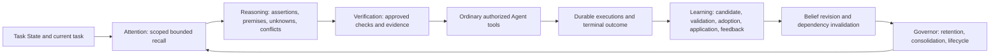

# Unified Cognitive Architecture

**Cognitive Core v1.0 integration:** `integ/cognitive-core-v1-20261116`, input `8c30f75`, protected main `00344b5`. Not merged or released. The capability version does not change the Core module version. [中文](architecture.zh-CN.md) · [Integration evidence](../reports/FINAL_COGNITIVE_CORE_V1_REPORT.md).

## One system, seven responsibilities

Core keeps one Go `runtime.Engine`, one Agent Loop, one SQLite store, the existing evaluator, maintenance lease, Governor and source-fence/purge machinery. The domains below describe responsibilities, not separate services.

| Domain | Problem and implementation | Shared output / boundary |
|---|---|---|
| Memory | Task State and bounded context hold working memory; Sessions/executions/checks are episodes; `cognition_candidates` and native graph beliefs are semantic records; typed Experience is procedural memory. | Source-preserving immutable revisions in the same store. No second memory database. |
| Attention | Existing Notes/thread recall and Context Graph remain the retrieval foundation. `knowledgeIndexRow` ranks task-relevant locators; `RecallExperiences` uses `threadctx.Tokens` and prioritizes matching warnings. | A score selects attention, never truth. Limits and required dependencies remain explicit. |
| Reasoning | The model interprets the task and proposes action. `AssessCognition`/`assess_cognition` evaluates exact assertions, pinned premises, freshness and contradictory peers. | `fact`, `inference`, `hypothesis`, `decision`, `unknown`, `experience`; `current`, `candidate_only`, `unknown`, `stale`, `conflict` applicability. Framework does not implement a universal proof engine. |
| Learning | `propose_experience` queues bounded structure. Terminal finalization extracts from the real episode and runs host-bound checks. Recall/adopt/apply connect that result to later Agent actions. | Adoption is not execution. Application receipts and independently checked feedback determine success/failure/unknown. |
| Belief Revision | Native revisions pin dependencies. Uses-only Experience revisions preserve a premise; changed definitions, validation, state, scope or lifecycle invalidate it. Counterexamples require an explicit new definition before revalidation. | History, outcome, reason and source identity remain. An unavailable premise yields stale without disclosing its content. No model self-approval. |
| Governance | Analyze/Plan/Validate remain deterministic. Host-only `GovernorApply`, `SetCognitiveLifecycle`, `MaintainCognitiveMemory` implement owned CAS lifecycle transactions. | Archive/tier/equivalent consolidation only; unsupported claim promotion/branch/epoch plans are refused. |
| Verification | Existing approved check/spec/binding + closed stable episode + source/fingerprint/approval epoch/privacy epoch establishes exact evidence. | An unexecuted or unapproved check never counts; process evidence is not portable between runs. |

## Shared semantics

- **Scope and ownership:** `knowledge.Scope`/`Reader` are derived from Engine/session/project/workspace identity. A revision cannot widen its audience. There is no implicit global knowledge authority. `readerID` is a trusted host API argument, not network authentication.
- **Time:** `Times` separates observation, recording, verification, valid interval and invalidation. Read-time freshness is evaluated against the reader now. CAS revision, not wall clock, orders writes.
- **Provenance:** `SourceRef` identifies the exact terminal session/run/version. `NodeRef` pins a premise revision. Existing `derived_origins` materializes exposure, including summaries, decisions and Experience consumers.
- **Evidence versus confidence:** only framework-created observations reference approved results. `ModelConfidence` is optional model judgment and grants no evidence level or execution permission.
- **Revision:** immutable graph versions use expected-version CAS; checks execute outside write transactions and authority/source/fences are rechecked inside. Lifecycle batches commit all or nothing. A canonical target cannot change in the same batch as aliases that pin it.
- **Privacy:** origin definition and consumer feedback are different disclosures. Public reads and mutation replies expose only the reader's own `Uses`. Origin-only readers do not inherit other consumers; reading a counterexample warning does create its actual aggregate dependency. Revocation overrides history availability.
- **Run identity:** `BeginRun` records `agent.start{runId}` in its transaction. The newest checkpoint by sequence, not wall-clock text, identifies a started run even before its first model request. Only older runs without this checkpoint fall back to the newest `main` request.
- **Two record families, one authority:** `cognition_candidates` and `cognition_nodes` share checks, assertion semantics, source fences and privacy cleanup, but retain distinct lifecycles and read paths. Cross-family conflict detection and automatic bridging are not implemented; “unified” does not claim otherwise.

## Data and execution flow

1. Host enables cognition and approves exact assertions/checks. These are separate permissions.
2. A normal run gets bounded relevant locators, reads Notes/knowledge/Experience as untrusted context and records evidence-aware decisions. A requested `continue` is not endorsed if prerequisites remain unknown, stale, incomplete or conflicting. Ask/defer/stop are explicit proposals, not hidden autonomous work.
3. The model may propose a structured conditional lesson during the run. It cannot provide source IDs, execution success, evidence or authority as self-certification.
4. The existing terminal boundary extracts the proposal against actual run/task/execution/check records. Complete failed episodes and negative outcomes are retained; an answer-only or incomplete episode cannot validate a procedure.
5. A later independent consumer checks every condition before adoption, then explicitly submits the same observed action sequence for application. `apply_experience` matches tool names/canonical argument digests; existing callback dispatch enforces ordinary policy, allowlists, workflow, budget and hooks. No commands are auto-replayed from stored prose.
6. The application receipt records durable execution IDs, including settled tool failures, and the expected outcome as its host-bound check observed it when the last action had settled. Full settled application plus that observation supports feedback; what the run does afterwards does not change it. Denial, cancellation, partial execution or unknown settlement never counts as success.
7. Counterexamples append `needs_revision` and retain all prior evidence. A changed definition returns to candidate state; a revoked identity cannot be restored. Archive/restore do not manufacture evidence.
8. Restart completes pending memory settlement under the session run lock; pending actions become unknown, never replay. Memory errors are separate from the already-observed Agent result.

Semantic extraction through `MaintainCognition` remains the existing optional, bounded maintainer path with the same approvals and source contracts. It is not a second learning loop or a substitute for application feedback.

## Production entrypoints and Context Space separation

`runtime` is the sole composition point. Cognitive packages do not import `internal/window` or a Context Space package; window code does not import cognition. Both stay in the same Go module. This integration does not implement ProjectPrefix, a Reference Directory, safepoint compaction or a second manager.

Existing `BeginRun(Notices, NoticeSources)` and tool-result provenance transactions remain the disclosure boundaries. The Start index automatically advertises maintenance candidates, **not Experience**. Experience recall/proposal/application tools require the model to select them; terminal settlement and recovery are framework-driven. Belief/negative/abstraction creation, Governor lifecycle and capacity maintenance remain host SDK actions, not automatic production learning. [The capability matrix](capabilities.md) identifies each entrypoint.

## Boundaries and trade-offs

- Only host-bound structured assertions can be checked as facts. Free prose, proposed causes and causal links are interpretations; a successful outcome proves neither the entire explanation nor causal benefit.
- Conditional reuse is deliberately exact-action: the model can recognize a related problem and select a procedure, but cannot silently parameterize or substitute its observed actions. New actions require a new observed candidate. This is not universal transfer.
- Memory consolidation only archives aliases with the same owned scope, assertion, body, source/evidence, dependencies and validity. Broader summaries remain new unverified proposals with source dependencies; lossy text is not a fact.
- Retention preserves safety, failures, counterexamples, high importance and dependencies. If only protected/active content remains, pressure is reported rather than deleting it. Logical tiers are not physical storage tiers.
- In-process local host trust remains the boundary. External backups/exports, physical SSD erasure, cross-project sharing and general autonomous learning gains are not claimed.
- **V-D1:** deleting/revoking any recorded consumer fences the aggregate Experience owner, making the shared Experience unavailable to all readers; privacy deletion also removes its derived records. A dependent that only used the validated origin is not itself fenced, but its premise becomes stale. This accepted v1.0 availability cost is not per-consumer storage isolation.
- **V-002/V-003:** a host tier change can stale an Experience pin; concurrent adoption may return CAS failure. Governor validation is advisory and does not mirror every commit-time rejection. These fail-closed limits remain; no new schema or retry mechanism is introduced.
- **Meaning of learning:** Experience is a Verified Procedural Macro, not general semantic transfer. `causal_benefit_unmeasured` remains the utility contract. [The roadmap](roadmap.md) separates v1.1 integration work from longer-term empirical questions.

[Memory lifecycle](memory-lifecycle.md) · [API](COGNITIVE_CORE_API.md) · [Implementation](COGNITIVE_CORE_IMPLEMENTATION.md) · [ADR-0023](../adr/0023-unified-cognitive-lifecycle.md).
